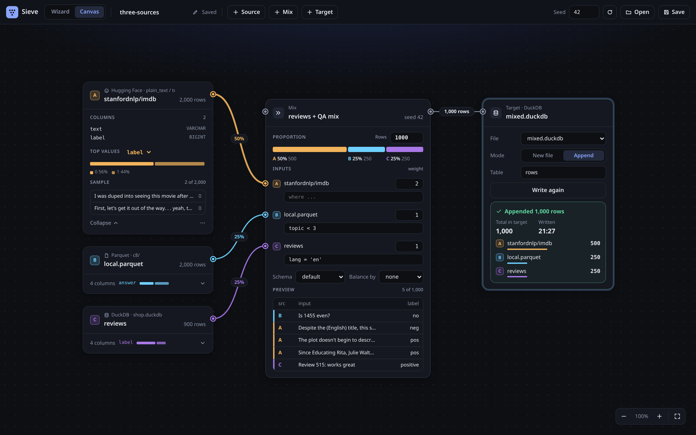

# Sieve Dataset Converter

Pull a dataset from Hugging Face or a Parquet, CSV, JSON, JSONL or DuckDB file, map it onto a schema you define, sample N rows and write them to a DuckDB file. It comes as a one-page web UI and an MCP server, so AI agents can run the same pipeline.

```bash
npm install && npm start    # UI at http://localhost:3000 · MCP (streamable HTTP) at /mcp
npm run mcp:stdio           # MCP over stdio
npm test                    # offline smoke test
```
Node 20+, no Docker. Env: `PORT` (3000), `DATA_DIR` (`data`: downloads and `.duckdb` targets), `SCHEMAS_DIR` (`schemas`), `HF_TOKEN` (gated or private HF datasets).

**Memory guards** (so a big request fails with an error instead of taking the box down): DuckDB runs with `SIEVE_DUCKDB_MEMORY` (default 25% of RAM) and spills to `DATA_DIR/.tmp`; reads stop with an error once the process passes `SIEVE_MAX_RSS_MB` (default 50% of RAM); an explode may make at most `SIEVE_MAX_ROWS` rows (5,000,000). A memory error is returned like any other error and the server keeps running; downloads are streamed to disk.

## Flow
**1 · Dataset**: type `org/name` and the config/split dropdown fills from the Hugging Face API. You can also paste a file URL or a local path. Choose a schema and how many rows to fetch (default 10,000, or `all`). With a limit, Hugging Face data is read remotely: DuckDB `httpfs` range-reads only the row groups it needs and stops across shards once the limit is reached (1,000 rows of a 41-shard Wikipedia split: ~14 MB instead of a 420 MB shard). By default (`fetch: "random"`) the rows are a seeded random subset of seeded random row groups spread over up to 16 shards, so a sorted split (e.g. IMDB, all `neg` first) still gives a mix. A row group gives at most `max_rows_per_group` rows (default `ceil(limit/16)`, so at least 16 groups when there are that many), or set `row_groups: N`. More groups spread the sample better but cost more bytes, because a group's column chunks are read whole: 1,000 IMDB rows give 1000/0 labels from 1 group (1.7 MB), 625/375 from 8 (7.6 MB), 559/441 from 16 (14.3 MB, the default) and 504/496 from all 25 (20.9 MB); 1,000 SHP rows cover 1, 6, 8, 12 and 15 of its subreddits with 1, 8, 16, 32 and 63 groups (1.2, 2.9, 5.1, 11.9 and 24.8 MB). The result reports `hf.row_groups`, `hf.network_bytes` (bytes downloaded, measured), `hf.data_bytes` (compressed column chunks the read needed, from the Parquet metadata) and `hf.cached_bytes` (the part of `data_bytes` that came from DuckDB's in-memory cache instead of the network; a re-import of the same rows in one server session downloads ~0 bytes, e.g. SHP 0 B with 4.6 MB cached, PKU-SafeRLHF 0 B with 9.9 MB cached); `fetch: "head"` takes the first N rows (small heads use the datasets-server `/rows` API). `all`, or a failed remote read, downloads whole shards. Only the columns the import needs are read: `columns` if given, else the roots of the `mapping`/`metadata`/`where` passed to the import (HelpSteer3, 2,000 rows: 7.0 MB with 4 columns vs 10.7 MB for all). `gold_from` columns in `field_options` are read too. The seeded sample in step 4 is drawn from the fetched rows. `source_row` is `shard × 10⁹ + row in shard`.


**2 · Mapping**: each schema field gets source columns suggested from its name and `aliases`. `join` fields take several columns, shown as chips. `target` (the `{probabilities}` distribution) is built from the label when left empty (`—`), or from its own columns (e.g. a soft score, or one score column per option). Over MCP a mapping entry can also be a nested path: `a.b[0].c`, or `completions[*].response` for a list of values.


**3 · Metadata**: a key/value list. Each value is either a constant or copied per row from a source column (a nested path or `source_row` works too). Constants keep JSON types: `3`, `true` and `[1,2]` are stored as a number, a boolean and a list. Choose the schema column it goes into (default `meta`). When a value is cut by `max_chars`/`max_items`, the row's metadata gets `truncated: true` and `truncated_fields`. The table previews converted rows.


**4 · Sample & write**: a seeded sample (500 rows, seed 42) goes into an existing `.duckdb` file (append) or a new one (create). Files are listed from `DATA_DIR`. Tick *Delete downloads after write* to remove the dataset's files from `data/downloads` once the write succeeds.


**Schemas**: edit or create a schema as JSON from the page.


## Canvas (boards)
`/canvas.html` (linked from the wizard header) is a whiteboard for sampling from many sources at once. It reads left to right: **Source → Mix → Target**, and every setting lives inside its card.
- **Source** cards are any import: Hugging Face, a Parquet/CSV/JSON/JSONL file or glob, a DuckDB table, or a Sieve output file in the data dir. Each source gets a color and a letter (A, B, C…) that it keeps on its wires, in the mix and in the results. A loaded card shows the row count, the columns with types, the top values of one column and a few sample rows; *Collapse* folds it to one line. Errors (a missing file, no access) show inside the card with *Retry* / *Edit source*.
- A **Mix** card has the row count, a stacked bar of the shares, one input row per source (relative weight plus a `where` filter), the schema and *Balance by*, and a live 5-row preview tagged by source. If a filter leaves a source with fewer rows than its share, its segment is hatched and its count turns red ("only 120 rows match"). The seed is set in the top bar (↻ rolls a new one) and shown on the mix.
- Wires take the source's color; thicker means a bigger share, and the label shows the %. The mix → target wire is dashed until the target is written.
- A **Target** card is a `.duckdb` file with a *New file* / *Append* toggle and the table. *Write* is the one filled button; afterwards the card lists the rows written per source and the total in the target. Any change upstream sets it back to ready (*Write N rows*) and dims the last result.

Drag the background (or hold space / the middle button) to pan, scroll or use the zoom pill at the bottom right (⤢ fits the board), drag cards by their header (shift-click to select several), and drag from an output port to a card to connect it; dropping a wire on empty canvas offers to add the next card there. Double-click the canvas to add a source; Delete removes the selected card or wire. Boards are saved as `data/boards/<name>.json`; `canvas.html?board=<name>` opens one, and boards made through the API or MCP get laid out automatically.



How a mix is sampled and written:
- the mix's `n` is split over its sources by weight with the largest-remainder method (1000 over weights 2/1/1 → 500/250/250);
- each source gets the same seeded sample `convert_and_write` would take (its `where`, then the mix's `stratify_by` / `balance` / `distinct_by`, within that source), converted to the mix schema; `meta` gets `board` and `board_source` (the source card id);
- writes go through `convert_and_write`, one per source, under one shared `write_key` (default `<board>-<mix>`). Rows of an earlier run under that key are replaced first, so re-running a board with the same seed writes the same rows, also after a restart (sources are re-imported with the same fetch seed). The result lists, per source, `requested`, `rows_written` and `pool_rows`, plus `short_by` when a source runs out.

Board JSON (also for the MCP tools):
```json
{ "name": "three-sources", "seed": 42,
  "nodes": [
    { "id": "imdb",  "type": "source", "url": "stanfordnlp/imdb", "limit": 2000 },
    { "id": "local", "type": "source", "url": "/data/local.parquet", "limit": "all" },
    { "id": "shop",  "type": "source", "target": "shop.duckdb", "table": "reviews", "limit": "all", "mapping": { "input": ["sentence"], "options": ["choices"], "label": ["label"] } },
    { "id": "mix",   "type": "mix", "schema": "default", "n": 1000 },
    { "id": "out",   "type": "target", "target": "mixed.duckdb", "mode": "auto" } ],
  "edges": [
    { "from": "imdb", "to": "mix", "weight": 2 },
    { "from": "local", "to": "mix", "weight": 1, "where": "topic < 3" },
    { "from": "shop", "to": "mix", "weight": 1, "where": "lang = 'en'" },
    { "from": "mix", "to": "out" } ] }
```
Source nodes take the import options (`url` or `target`, `config`, `split`, `table`, `format`, `limit`, `fetch`, `fetch_seed`, `columns`, `row_groups`, `explode`, `mapping`, `field_options`, `metadata`). Mix nodes: `schema`, `n` (500), `seed` (board seed), `stratify_by`, `balance`, `distinct_by`, `max_per_value`, `skip_unknown_labels`, `overrides`, `field_options`, `metadata`, `write_key`. Edges source → mix: `weight` (1), `where`, `mapping`, `overrides`, `field_options`, `metadata` for that source. Cards may carry `x`/`y`, the board a `view`. HTTP: `GET /api/boards`, `GET /api/boards/:name`, `POST /api/boards` (save), `POST /api/boards/source` (`{node, schema}` → card info), `POST /api/boards/preview` and `POST /api/boards/run` (`{name}` or `{board}`, `mix?`, `target?`, `n?`).

## Sources
| source | how |
|---|---|
| Hugging Face | `org/name`, `https://huggingface.co/datasets/org/name`, plus optional `config` and `split` (default: `train`). Shards come from the datasets-server Parquet export, or the Hub's `refs/convert/parquet` branch when that fails. ClassLabel names are read from the Parquet metadata. Without a `config` the `default` config is used, else the first one that has the split. Access is checked first (`/auth-check`) for imports and the config/split list (`hf_splits`), so a gated dataset without access fails with the same status and message everywhere, for any config or split, with a message to request access on the dataset page (for the account of `HF_TOKEN`), and a missing repo says so; script-only datasets with no Parquet export fail with a clear error |
| Earlier downloads | a `dataset_id` (its files in `data/downloads`), or a glob such as `data/downloads/*.parquet`; several files are read as one table. The Hugging Face repo stays the `url`/`origin` |

**Explode** (`explode` on import): one row per element of a list column or path, for next-action data. `explode: "actions"` or `{column, as?, history?, extract?}`: the element goes into `as` (default: the column, or the last name of a path), and the columns `explode_step` (0-based), `explode_steps` and, with `history` (`N` = the preceding N elements, `true` = up to 100), `explode_history` are added; `meta` gets `step` and `steps`. `source_row` becomes `source row × 1000 + step` (lists are cut at 1,000 elements). JSON-text lists work too. The list column itself is dropped from the exploded rows (each row would otherwise carry the whole trajectory); to keep values from it, name them in `extract: {name: path}`, e.g. `{"task": "trajectory[1].content"}`. Paths into the list given in the import's `mapping`/`metadata`/`field_options` are extracted automatically under their own name. The explode runs in DuckDB, in batches of source rows, into Parquet files next to the download. SWE-rebench-openhands (`explode: {column: "trajectory", as: "turn", history: 2}`): 250 trajectories → 32,631 turns at 2.1 GB peak RSS, 1,100 → 143,251 turns at 3.1 GB (before: about 11 GB for 250, and 1,100 ran the box out of memory). Steps of one source row can land in different writes or splits; use `distinct_by` (e.g. a task id) for one step per trajectory. E.g. Mind2Web (1,009 tasks, `explode: {column: "action_reprs", as: "action", history: true}`, input = task + history, label = action) gives 7,143 steps (1.4 MB downloaded); SWE-agent-trajectories (300 trajectories, `explode: {column: "trajectory", as: "turn", history: 3}`) gives 16,508 turns (8,104 `ai`).
| Parquet / CSV / TSV / JSON / JSONL | URL, local path or glob, detected by extension (or pass `format`) |
| DuckDB | `.duckdb` / `.db` URL or local path, attached read-only. `tables` lists what's inside; choose one with `table` (default: the first) |

## Schemas
Schemas are JSON files in `schemas/`. Each one writes to its own table. `examples/schemas/qa_pair.json` shows a minimal one, and you can copy it into `schemas/` or post it through `save_schema`.

```json
{ "name": "qa_pair", "table": "qa_pair", "fields": [
  { "name": "question", "type": "text", "required": true, "max_chars": 300, "aliases": ["question"] },
  { "name": "answer",   "type": "text", "max_chars": 100, "aliases": ["answer", "answerkey"] },
  { "name": "domain",   "type": "text", "transform": "metadata", "value": "domain" } ] }
```
- **type**: `text`, `number`, `integer`, `boolean`, `list` (stored as JSON), `json`
- **transform**:
  - `copy` (default) and `first`
  - `join`: several columns as `col: value` lines
  - `constant`: uses `value`
  - `metadata`: the metadata entry whose key is `value`
  - `meta`: the default column for the per-row metadata object
  - `label_to_option`: turns a label into option text from `option_field`. `label_mode` says how the label is read: `text` (option text, option id, HF `{label:[…]}` key or ClassLabel name), `index` (0-based number or letter), `numeric` (the option equal to the number), or `auto` (default: text, then numeric when all options are numbers, else index; numeric options never fall back to an index). A list of labels (multi-label) becomes a list of option texts. With no options, ClassLabel names are used as the options. When the label is missing or not an option, it becomes the argmax option of the field's distribution (e.g. a binned score)
  - `label_to_distribution`: writes `{"probabilities": {id: p}}` over the options of `option_field` (`"as": "list"` gives `[{id, p}]`). Probabilities sum to 1. A label gives a one-hot vector, and a list of labels is spread evenly. A numeric value is split between the two nearest numeric options, or, with two options and a value in [0, 1], gives the second option probability p. Several numeric columns (one per option) are normalised. Without its own columns it reads the source of `label_field` (default: the `label_to_option` field)
  - `options_dict`: the ordered list `[{id, text}]` for `option_field` (`"as": "object"` gives `{id: text}`)
  - `shuffle`: a seeded shuffle of its columns (e.g. `["chosen", "rejected"]`) or of one list column. The gold item is the first one, or the one `gold_from` picks per row:
    - `{column, map?}`: the column value, through `map`, is an item index or a mapped column name, e.g. `{"column": "labels", "map": {"1": "human_ref_A", "0": "human_ref_B"}}`
    - `{argmax_of: [paths], ties?}`: one score path per item; the item with the highest score is gold. With `ties: "skip"` (default) a row with a tie or no scores is skipped, and the write takes the next sampled row instead, so it still gets `n` rows (`rows_skipped` counts them); `ties: "first"` takes the first best item. E.g. UltraFeedback best-of-4: options `completions[0].response` … `completions[3].response`, `argmax_of` `completions[0].overall_score` … `completions[3].overall_score`

    The gold item's index after shuffling goes to `gold_field` (or `meta.gold_index`)
  - **empty options**: an option or shuffle item that is empty, whitespace-only or null makes the row skipped (writes refill it with the next sampled row; preview shows `_skipped`). Set `"allow_empty": true` on the field (or in `field_options`) to keep such rows
  - **duplicate options**: a row whose option or shuffle texts repeat (after trim) is skipped and refilled too, because the choice is ambiguous (hh-rlhf: 76 of 20,000 rows have `chosen` = `rejected`; a 5,000-row write skipped 22). `"duplicates": "drop"` on a shuffle field removes the repeated non-gold items and keeps the row; `"keep"` (or `"allow_duplicates": true`) keeps them, and the repeated texts then get ids `x`, `x#2`
  - **unknown labels**: `"skip_unknown": true` on a `label_to_option` field (or `skip_unknown_labels: true` on a write) skips and refills rows whose label is not one of the non-empty options, instead of writing them with a null or out-of-options target. Results list `skip_reasons`
  - **value_from** `{column, map?}` on any field: the value of a column or path, mapped through `map`: exact keys first, then `"/regex/flags"` keys in order, then `"*"` (any other value), e.g. a label from `{"column": "target", "map": {"true": "resolved", "*": "unresolved"}}` or `{"column": "turn.tool_calls[0].function.name", "map": {"/^(finish|submit)$/": "true", "*": "false"}}`
  - **ClassLabel names** are found inside structs and lists too (`answers.label` for `answers: {label: ClassLabel}`)
  - **option ids** are the option texts, with repeats made unique (`yes`, `no`, `yes#2`). `"ids": "index"` gives `"0"`, `"1"`, … Options given as `[{id, text}]` or `{id: text}` (e.g. `{"true": "Yes", "false": "No"}`) keep their ids, and a label may be the id. Duplicate explicit ids are an error. `{id: …}` objects are written in option order, also when ids look like numbers (`{"10": …, "2": …}`): Sieve writes the JSON text itself, and DuckDB keeps it. Readers differ: Python's `json` keeps that order, JavaScript's `JSON.parse` moves integer-like keys first; use the `[{id, text}]` list or `"as": "list"` when the reader must keep order
- **limits and rules**: `max_chars`, `max_items`, `item_max_chars`, `required` (rows missing it are skipped and refilled), `enum`, `default`

The built-in `default` schema holds decision rows: `domain`, `decision_type` (`choice` | `noul` | `score`), `input` (≤ 4000 chars), `options` (≤ 16 × 200 chars), `label` (≤ 500 chars), `score`, `target` (`{probabilities}` built from the label) and `meta`.

## DuckDB layout
**`<schema.table>`** (e.g. `rows`): one row per sampled record
| column | type | |
|---|---|---|
| id | VARCHAR PK | `<dataset_id>-<source_row>` (`<dataset_id>-<write_key>-<source_row>` with a write key) |
| dataset_id | VARCHAR | |
| write_key | VARCHAR | `''`, or the `write_key` / split tag of the write |
| source_row | BIGINT | row index in the source |
| *schema fields* | per `type` | `text`→VARCHAR, `number`→DOUBLE, `integer`→BIGINT, `boolean`→BOOLEAN, `list`/`json`→JSON |
| *metadata column* (e.g. `meta`) | JSON | `{key: value}` for every metadata entry; column-sourced values differ per row |
| created_at | TIMESTAMP | |

**`datasets`**: one row per dataset, table and write key: `dataset_id, write_key, schema_name, table_name, name, metadata JSON ({entries, column}), url, origin JSON, source_key, format, source_rows, rows_written, sample_seed, filter, mapping JSON, written_at`. `source_key` identifies the source (`hf:org/name/config/split`) for `exclude_same_source`.

Writing the same `dataset_id` and `write_key` again replaces those rows. `create` fails if the file already exists, and `append` fails if it doesn't. Files written by older versions are upgraded on the next write: new columns are added and existing rows are kept.

**field_options**: `{field: {property: value}}` overrides schema field properties for one dataset, write or split without editing the schema, e.g. `{"label": {"label_mode": "index"}, "options": {"gold_from": {"column": "labels"}}}`.

**Overrides and field options: kept or one write.** Given to `set_metadata` (or `run_pipeline`'s `field_options`), they are stored on the dataset and used by every later write; merged by field, a `null` value removes one field's entry, and `clear_overrides` / `clear_field_options: true` drop all stored ones first (so clear + new = replace). Given to `convert_and_write` (or a split, or `run_pipeline`'s `overrides`), they apply to that write only and are not stored.

**Sampling**: `convert_and_write` takes a seeded random sample of the fetched rows. `where` filters it first (a DuckDB expression over source columns, e.g. `label >= 0 AND length(text) < 2000`; statements, subqueries and file functions are rejected). To keep samples disjoint:
- `splits: [{tag, n, metadata?, overrides?, mapping?, field_options?}]` cuts one shuffled sample into parts, each written with `write_key = tag`. `mapping` and `field_options` change the mapping or field properties for that part only.
- `exclude_same_source: true` skips source rows already written to the target from the same source, and `exclude_dataset_ids` skips the rows of those dataset ids.
- `stratify_by: "column"` (or a path such as `meta.lang`, `items[0].kind`) spreads the sample evenly over the column's values: one row of every value, then a second of every value, and so on, so values that run short are topped up from the others. It works across `splits` (each part takes the next rows of that order) and the result reports `strata` (rows written per value, top 100) and `strata_values`, overall and per split. E.g. 4,000 SHP rows with 15 subreddits (64–608 rows each), two splits of 540: split `a` got 36 of every subreddit; in split `b` the five subreddits that had only 64 rows ran out at 28, and the others were topped up to 39–41.
- `balance: "label"` does the same for a schema field: its value is computed in DuckDB from the field's `value_from` map (regex keys too) or its mapped source column, so the pool is never loaded into memory. SWE-agent `ai` turns (11% resolved): 400 rows with `balance: "label"` gave 200/200, without it 42/358. It uses the first split's mapping, and can't be combined with `stratify_by`. Fixed fields (overrides, constants) can't be balanced.
- `distinct_by: "column"` (or path) keeps at most `max_per_value` rows (default 1) per value in a write (all splits together), e.g. one step per Mind2Web task (500 of 929 tasks); rows where it is null are kept. With `stratify_by` or `balance` it applies within each stratum, so a rare value is not lost because another row of the same task was picked first: SWE-rebench (1,100 trajectories, finish vs continue, `distinct_by: "trajectory_id"`) gives 250/250.
- **Order**: `where` → `exclude_*` → `distinct_by` (per stratum) → stratified interleave → seeded order → convert, skipping and refilling bad rows → splits take consecutive rows. The pool is kept in DuckDB as row keys only and read in batches of at most 1,000 rows.
- `compact: true` (on `convert_and_write`, `delete_dataset`, `copy_rows`) or the `compact_target` tool rewrites the target file without the space left by replaced or deleted rows (checkpoint, copy every table into a new file, swap) and reports `bytes_before` / `bytes_after`; e.g. 37.2 MB → 13.4 MB after deleting 1,000 trajectory rows.

## MCP tools
| tool | params |
|---|---|
| `list_schemas` | – |
| `get_schema` | `name` |
| `save_schema` | `schema` (JSON as above; a new `name` creates a schema) |
| `hf_splits` | `dataset` → configs/splits with row counts |
| `list_targets` | – → `.duckdb` files in `DATA_DIR` |
| `import_dataset` | `url`, `schema="default"`, `config?`, `split?`, `table?` (DuckDB source), `format?`, `limit?` (10000 \| n \| `"all"`), `fetch?` (`"random"` \| `"head"`), `seed?` (random fetch, 42), `max_rows_per_group?`, `row_groups?`, `columns?` (default: from `mapping`, `field_options` and `explode`), `explode?`, `mapping?`, `field_options?`. A `url` may be a `dataset_id` or glob of earlier downloads. `limit: "all"` downloads whole shards, or with `columns` reads only those columns of every shard (IMDB `columns: ["label"]`: 2.5 KB instead of 21 MB). Result has `hf.via` (`httpfs` \| `rows-api` \| `download`), `hf.network_bytes` (bytes fetched over the network, for every route) and `download_bytes` (bytes on disk) |
| `preview` | `dataset_id`, `n?` (default 5, max 50; 0 for counts only), `where?`, `offset?`, `random?` + `seed?` (seeded random rows instead of the first), `value_counts?: {column, top? (20), where?}` → `value_counts: {rows, distinct_values, values: [{value, count}]}` over the imported rows that match `where` and `value_counts.where`. The column may be a path, also into JSON text (`turn.tool_calls[0].function.arguments.command`) |
| `set_metadata` | `dataset_id`, `metadata?: [{key, value} \| {key, column}]` (column may be a path or `source_row`), `target_column?` (null disables), `schema?`, `table?`, `mapping?: {field: [cols]}`, `overrides?: {field: value}` (null removes one), `field_options?`, `clear_overrides?`, `clear_field_options?` — stored for later writes |
| `convert_and_write` | `dataset_id`, `sample=500`, `seed=42`, `target="datasets.duckdb"`, `mode="append"` \| `"create"`, `cleanup=false` (delete this dataset's downloads after a successful write), `write_key?`, `metadata?`, `overrides?`, `mapping?` and `field_options?` (this write only, merged by key), `where?`, `splits?`, `exclude_same_source?`, `exclude_dataset_ids?`, `stratify_by?`, `balance?`, `distinct_by?`, `max_per_value?`, `skip_unknown_labels?`, `compact?`. Rows skipped (a required field missing, a gold tie, an unknown label) are replaced by the next sampled rows; the result has `rows_skipped` and `skip_reasons` |
| `run_pipeline` | everything above in one call (`metadata` is the dataset metadata, `fetch_seed` the random-fetch seed); `mode` defaults to append if the target exists, else create |
| `delete_dataset` | `dataset_id`, `target`, `write_key?`, `compact?` → removes its rows (all write keys, or one) and its `datasets` records |
| `compact_target` | `target` → rewrites the file without the space of deleted/replaced rows; `bytes_before`, `bytes_after`, `bytes_saved`. Also `POST /api/compact` |
| `cleanup_downloads` | `dataset_id?` → deletes that dataset's files in `data/downloads` (all when omitted); returns `files_deleted`, `bytes_freed` |
| `list_datasets` | – |
| `profile` | `dataset_id`, `top?` (5), `where?` → for every column: type, nulls, distinct count and top values (text cut at 80 chars) |
| `copy_rows` | `source_target`, `target`, `table?` (default: the only one besides `datasets`), `where?`, `n?` (seeded sample), `seed?`, `compact?` → copies written rows with their `id`, `source_row`, `meta`, `write_key`, `created_at`, and their `datasets` records (`rows_written` recounted); rows with the same `id` are replaced. Also `POST /api/copy` |
| `save_board` | `board` (JSON above) → saves `data/boards/<name>.json` |
| `get_board` / `list_boards` | `name` / – |
| `preview_mix` | `name` or `board`, `mix?` (default: the only mix), `n?` (20, max 500) → combined sample, rows tagged with `_source`, per-source `requested` / `rows` / `pool_rows`; nothing is written |
| `run_board` | `name` or `board`, `mix?`, `target?` → writes every mix connected to a target; per-source counts, `write_key`, `replaced_rows` |

Optional params also accept `null` (same as leaving them out; for `target_column`, null disables it).

```json
{ "tool": "run_pipeline", "arguments": {
  "url": "allenai/ai2_arc", "config": "ARC-Easy", "split": "train", "limit": 5000,
  "metadata": [{ "key": "domain", "value": "science-qa" }, { "key": "question_id", "column": "id" }],
  "target_column": "meta", "sample": 500, "target": "science.duckdb", "mode": "create" } }
```
```json
{ "tool": "convert_and_write", "arguments": {
  "dataset_id": "1a2b3c4d", "target": "nli.duckdb", "where": "label >= 0",
  "splits": [{ "tag": "retrieval", "n": 500, "metadata": { "use_case_id": "retrieval_sufficiency_check" } },
             { "tag": "conflict",  "n": 500, "metadata": { "use_case_id": "evidence_conflict_detection" } }],
  "cleanup": true } }
```
```json
{ "tool": "save_schema", "arguments": { "schema": { "name": "pairwise", "fields": [
  { "name": "prompt",  "type": "text" },
  { "name": "options", "type": "list", "transform": "shuffle", "gold_field": "label" },
  { "name": "label",   "type": "text", "transform": "label_to_option", "option_field": "options" },
  { "name": "target",  "type": "json", "transform": "label_to_distribution", "option_field": "options", "ids": "index" },
  { "name": "meta",    "type": "json", "transform": "meta" } ] } } }
```
Map `options` to `["chosen", "rejected"]` (e.g. `Anthropic/hh-rlhf`), and the gold answer lands at a random, seeded position.
```json
{ "tool": "import_dataset", "arguments": { "url": "/data/zoo.duckdb", "table": "iris", "limit": "all" } }
```
Imported datasets live in memory for each process. The UI and `/mcp` share that state; a stdio process keeps its own.

## License
MIT
