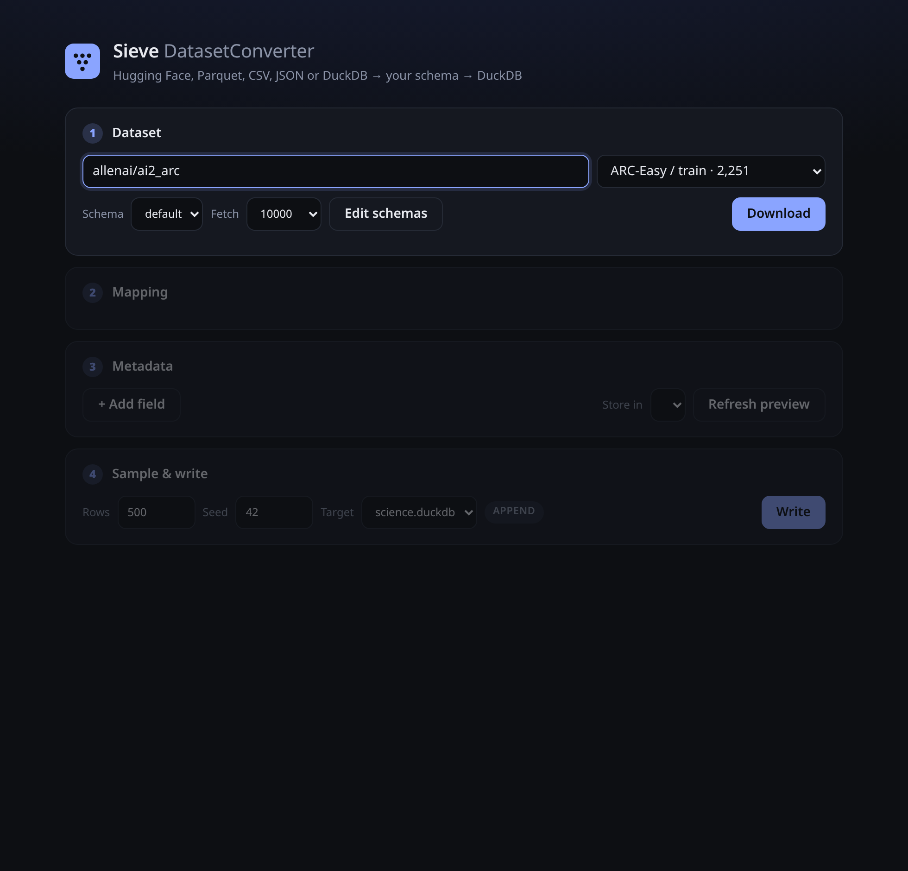
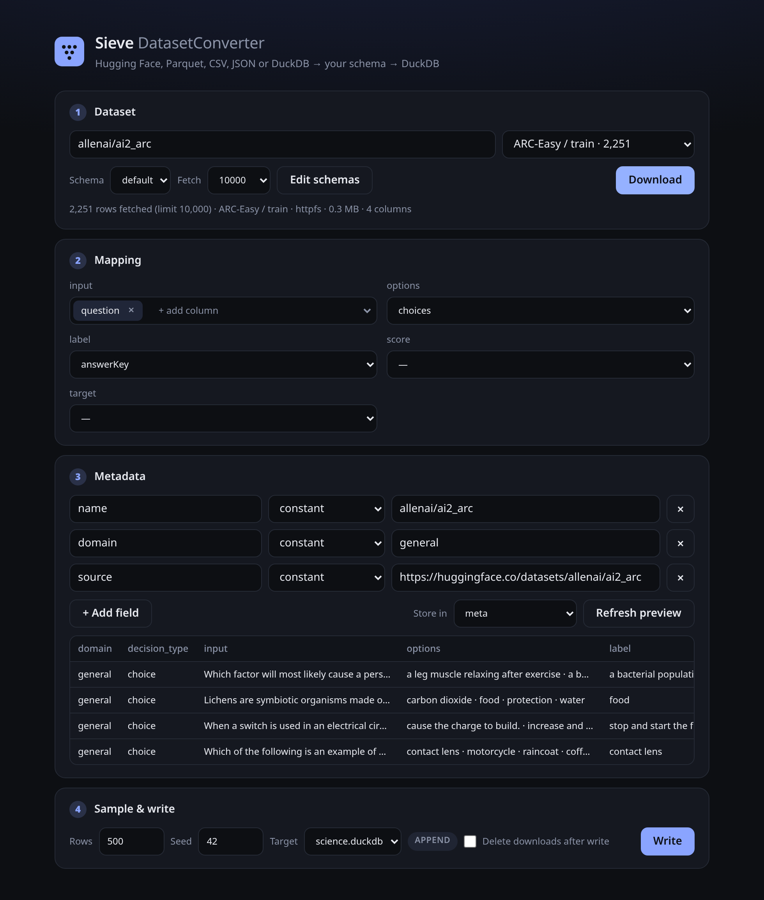
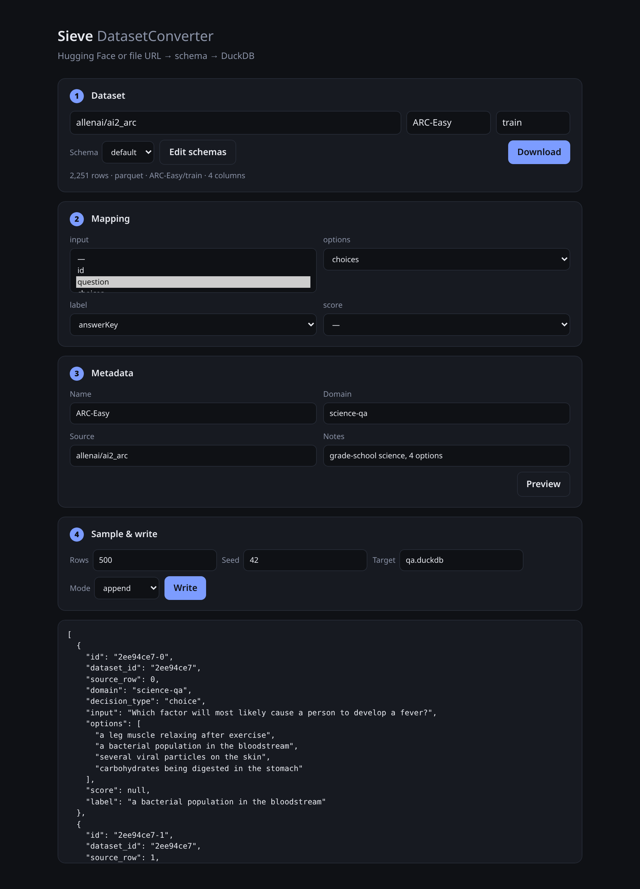
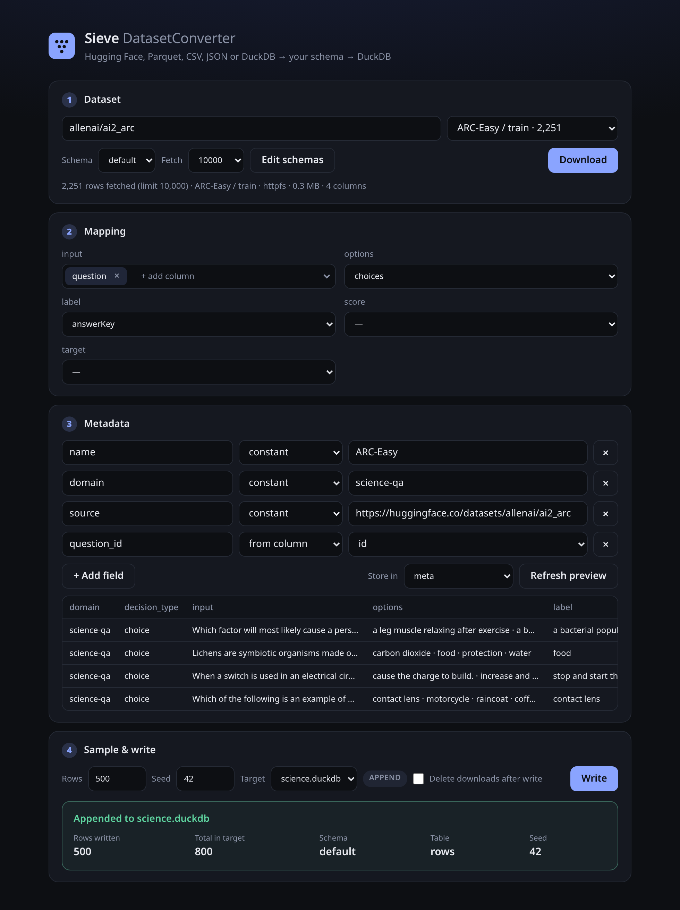
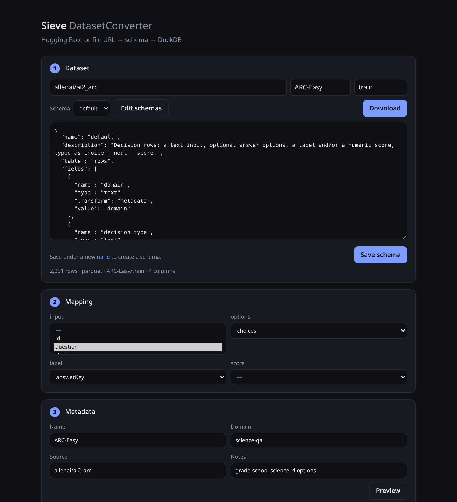

# Sieve Dataset Converter

Pull a dataset from Hugging Face or a Parquet, CSV, JSON, JSONL or DuckDB file, map it onto a schema you define, sample N rows and write them to a DuckDB file. It comes as a one-page web UI and an MCP server, so AI agents can run the same pipeline.

```bash
npm install && npm start    # UI at http://localhost:3000 · MCP (streamable HTTP) at /mcp
npm run mcp:stdio           # MCP over stdio
npm test                    # offline smoke test
```
Node 20+, no Docker. Env: `PORT` (3000), `DATA_DIR` (`data`: downloads and `.duckdb` targets), `SCHEMAS_DIR` (`schemas`), `HF_TOKEN` (gated or private HF datasets).

## Flow
**1 · Dataset**: type `org/name` and the config/split dropdown fills from the Hugging Face API. You can also paste a file URL or a local path. Choose a schema and how many rows to fetch (default 10,000, or `all`). With a limit, Hugging Face data is read remotely: DuckDB `httpfs` range-reads only the row groups it needs and stops across shards once the limit is reached (1,000 rows of a 41-shard Wikipedia split: ~14 MB instead of a 420 MB shard). Small limits fall back to the datasets-server `/rows` API, and `all` (or a failed remote read) downloads whole shards. A limit takes the **first** N rows of the split, not a random subset; the seeded sample in step 4 is drawn from those rows.


**2 · Mapping**: each schema field gets source columns suggested from its name and `aliases`. `join` fields take several columns, shown as chips. Over MCP a mapping entry can also be a nested path: `a.b[0].c`, or `completions[*].response` for a list of values.


**3 · Metadata**: a key/value list. Each value is either a constant or copied per row from a source column (a nested path or `source_row` works too). Constants keep JSON types: `3`, `true` and `[1,2]` are stored as a number, a boolean and a list. Choose the schema column it goes into (default `meta`). When a value is cut by `max_chars`/`max_items`, the row's metadata gets `truncated: true` and `truncated_fields`. The table previews converted rows.


**4 · Sample & write**: a seeded sample (500 rows, seed 42) goes into an existing `.duckdb` file (append) or a new one (create). Files are listed from `DATA_DIR`. Tick *Delete downloads after write* to remove the dataset's files from `data/downloads` once the write succeeds.


**Schemas**: edit or create a schema as JSON from the page.


## Sources
| source | how |
|---|---|
| Hugging Face | `org/name`, `https://huggingface.co/datasets/org/name`, plus optional `config` and `split` (default: `train`). Shards come from the datasets-server Parquet export, or the Hub's `refs/convert/parquet` branch when that fails. ClassLabel names are read from the Parquet metadata. Re-importing a file from `data/downloads` keeps the Hugging Face repo as its `url`/`origin` |
| Parquet / CSV / TSV / JSON / JSONL | URL or local path, detected by extension (or pass `format`) |
| DuckDB | `.duckdb` / `.db` URL or local path, attached read-only. `tables` lists what's inside; choose one with `table` (default: the first) |

## Schemas
Schemas are JSON files in `schemas/`. Each one writes to its own table. `examples/schemas/qa_pair.json` shows a minimal one, and you can copy it into `schemas/` or post it through `save_schema`.

```json
{ "name": "qa_pair", "table": "qa_pair", "fields": [
  { "name": "question", "type": "text", "required": true, "max_chars": 300, "aliases": ["question"] },
  { "name": "answer",   "type": "text", "max_chars": 100, "aliases": ["answer", "answerkey"] },
  { "name": "domain",   "type": "text", "transform": "metadata", "value": "domain" } ] }
```
- **type**: `text`, `number`, `integer`, `boolean`, `list` (stored as JSON), `json`
- **transform**:
  - `copy` (default) and `first`
  - `join`: several columns as `col: value` lines
  - `constant`: uses `value`
  - `metadata`: the metadata entry whose key is `value`
  - `meta`: the default column for the per-row metadata object
  - `label_to_option`: turns an index, a letter, a ClassLabel id or an HF `{label:[…]}` key into option text from `option_field`. A list of labels (multi-label) becomes a list of option texts. With no options, ClassLabel names are used as the options
  - `label_to_distribution`: writes `{"probabilities": {id: p}}` over the options of `option_field`. A label gives a one-hot vector, and a list of labels is spread evenly. A numeric value is split between the two nearest numeric options, or, with two options and a value in [0, 1], gives the second option probability p. Several numeric columns (one per option) are normalised. Without its own columns it reads the source of `label_field` (default: the `label_to_option` field)
  - `options_dict`: `{id: option}` for `option_field`
  - `shuffle`: a seeded shuffle of its columns (e.g. `["chosen", "rejected"]`) or of one list column. The first item is the gold one, and its index after shuffling goes to `gold_field` (or `meta.gold_index`)
  - option ids are the option texts; set `"ids": "index"` on `label_to_distribution`/`options_dict` for `"0"`, `"1"`, …
- **limits and rules**: `max_chars`, `max_items`, `item_max_chars`, `required` (rows missing it are skipped), `enum`, `default`

The built-in `default` schema holds decision rows: `domain`, `decision_type` (`choice` | `noul` | `score`), `input` (≤ 4000 chars), `options` (≤ 16 × 200 chars), `label` (≤ 500 chars), `score`, `target` (`{probabilities}` built from the label) and `meta`.

## DuckDB layout
**`<schema.table>`** (e.g. `rows`): one row per sampled record
| column | type | |
|---|---|---|
| id | VARCHAR PK | `<dataset_id>-<source_row>` (`<dataset_id>-<write_key>-<source_row>` with a write key) |
| dataset_id | VARCHAR | |
| write_key | VARCHAR | `''`, or the `write_key` / split tag of the write |
| source_row | BIGINT | row index in the source |
| *schema fields* | per `type` | `text`→VARCHAR, `number`→DOUBLE, `integer`→BIGINT, `boolean`→BOOLEAN, `list`/`json`→JSON |
| *metadata column* (e.g. `meta`) | JSON | `{key: value}` for every metadata entry; column-sourced values differ per row |
| created_at | TIMESTAMP | |

**`datasets`**: one row per dataset, table and write key: `dataset_id, write_key, schema_name, table_name, name, metadata JSON ({entries, column}), url, origin JSON, source_key, format, source_rows, rows_written, sample_seed, filter, mapping JSON, written_at`. `source_key` identifies the source (`hf:org/name/config/split`) for `exclude_same_source`.

Writing the same `dataset_id` and `write_key` again replaces those rows. `create` fails if the file already exists, and `append` fails if it doesn't. Files written by older versions are upgraded on the next write: new columns are added and existing rows are kept.

**Sampling**: `convert_and_write` takes a seeded random sample of the fetched rows. `where` filters it first (a DuckDB expression over source columns, e.g. `label >= 0 AND length(text) < 2000`; statements, subqueries and file functions are rejected). To keep samples disjoint:
- `splits: [{tag, n, metadata?, overrides?}]` cuts one shuffled sample into parts, each written with `write_key = tag`.
- `exclude_same_source: true` skips source rows already written to the target from the same source, and `exclude_dataset_ids` skips the rows of those dataset ids.

## MCP tools
| tool | params |
|---|---|
| `list_schemas` | – |
| `get_schema` | `name` |
| `save_schema` | `schema` (JSON as above; a new `name` creates a schema) |
| `hf_splits` | `dataset` → configs/splits with row counts |
| `list_targets` | – → `.duckdb` files in `DATA_DIR` |
| `import_dataset` | `url`, `schema="default"`, `config?`, `split?`, `table?` (DuckDB source), `format?`, `limit?` (10000 \| n \| `"all"`; HF reads only the first n rows remotely). Result has `hf.via` (`httpfs` \| `rows-api` \| `download`) and `download_bytes` |
| `preview` | `dataset_id`, `n?`, `where?` |
| `set_metadata` | `dataset_id`, `metadata?: [{key, value} \| {key, column}]` (column may be a path or `source_row`), `target_column?` (null disables), `schema?`, `table?`, `mapping?: {field: [cols]}`, `overrides?: {field: value}` |
| `convert_and_write` | `dataset_id`, `sample=500`, `seed=42`, `target="datasets.duckdb"`, `mode="append"` \| `"create"`, `cleanup=false` (delete this dataset's downloads after a successful write), `write_key?`, `metadata?` and `overrides?` (this write only, merged by key), `where?`, `splits?`, `exclude_same_source?`, `exclude_dataset_ids?` |
| `run_pipeline` | everything above in one call (`metadata` is the dataset metadata); `mode` defaults to append if the target exists, else create |
| `delete_dataset` | `dataset_id`, `target`, `write_key?` → removes its rows (all write keys, or one) and its `datasets` records |
| `cleanup_downloads` | `dataset_id?` → deletes that dataset's files in `data/downloads` (all when omitted); returns `files_deleted`, `bytes_freed` |
| `list_datasets` | – |

```json
{ "tool": "run_pipeline", "arguments": {
  "url": "allenai/ai2_arc", "config": "ARC-Easy", "split": "train", "limit": 5000,
  "metadata": [{ "key": "domain", "value": "science-qa" }, { "key": "question_id", "column": "id" }],
  "target_column": "meta", "sample": 500, "target": "science.duckdb", "mode": "create" } }
```
```json
{ "tool": "convert_and_write", "arguments": {
  "dataset_id": "1a2b3c4d", "target": "nli.duckdb", "where": "label >= 0",
  "splits": [{ "tag": "retrieval", "n": 500, "metadata": { "use_case_id": "retrieval_sufficiency_check" } },
             { "tag": "conflict",  "n": 500, "metadata": { "use_case_id": "evidence_conflict_detection" } }],
  "cleanup": true } }
```
```json
{ "tool": "save_schema", "arguments": { "schema": { "name": "pairwise", "fields": [
  { "name": "prompt",  "type": "text" },
  { "name": "options", "type": "list", "transform": "shuffle", "gold_field": "label" },
  { "name": "label",   "type": "text", "transform": "label_to_option", "option_field": "options" },
  { "name": "target",  "type": "json", "transform": "label_to_distribution", "option_field": "options", "ids": "index" },
  { "name": "meta",    "type": "json", "transform": "meta" } ] } } }
```
Map `options` to `["chosen", "rejected"]` (e.g. `Anthropic/hh-rlhf`), and the gold answer lands at a random, seeded position.
```json
{ "tool": "import_dataset", "arguments": { "url": "/data/zoo.duckdb", "table": "iris", "limit": "all" } }
```
Imported datasets live in memory for each process. The UI and `/mcp` share that state; a stdio process keeps its own.

## License
MIT
